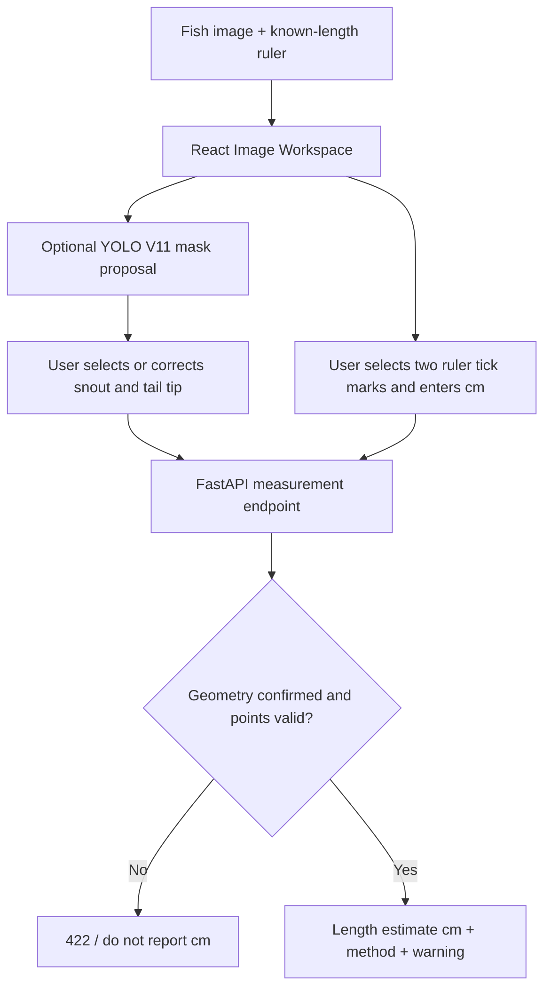
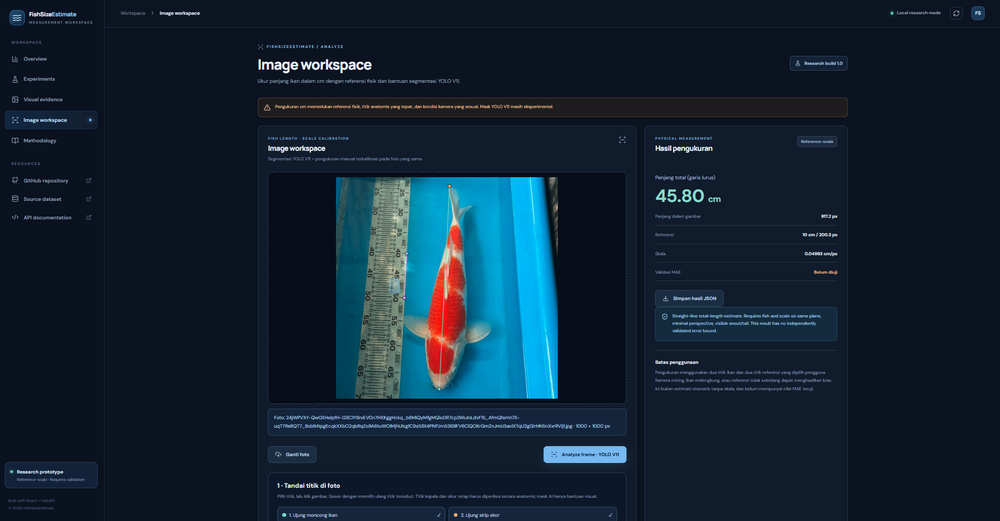

# FishSizeEstimate | Day 39 / 100 Days of Projects

**English:** [Full English documentation](docs/en/README.md) · **Bahasa Indonesia:** [Dokumentasi lengkap](docs/id/README.md) · [Documentation index](docs/README.md)

> **Status (22 Nov 2026):** Reference-scale manual measurement workflow demonstrated locally; AI segmentation remains experimental. **No independently validated fish-length MAE/RMSE.** This is not an automatic centimetre-regression model or a production-certified measuring instrument.

## Executive summary / Ringkasan

FishSizeEstimate helps a user estimate **straight-line total fish length in centimetres** from an image with a visible, known-length reference. The user selects snout, tail-tip, and two ruler reference positions, enters actual ruler distance, confirms approximate coplanarity, and requests a deterministic backend calculation. A trained YOLO11n-seg checkpoint supplies **optional fish-mask proposals only**; it does **not** infer centimetres or guarantee anatomical endpoints.

FishSizeEstimate membantu estimasi **panjang total ikan garis lurus dalam cm** dari foto dengan referensi ukuran yang diketahui. Empat titik dipilih pengguna, kemudian backend menghitung panjang berdasarkan skala. YOLO V11 membantu usulan mask, bukan memprediksi cm. Keakuratan pengukuran terhadap panjang asli **belum divalidasi secara independen**.

## Problem, users and scope / Masalah, pengguna dan cakupan

- **Problem:** Physical sampling for aquaculture fish measurements is labor-intensive; photos can help only when a reliable physical scale is supplied.
- **Users:** fish farmers, aquaculture researchers, and CV practitioners validating measurement workflows.
- **Input:** JPG/PNG/WebP with visible fish and ruler/known-length scale, real reference length in cm, four image points, explicit geometry confirmation.
- **Output:** fish line length in px, ruler segment in px, cm/px, straight-line estimated length in cm, validity/limitations, optional saved JSON.
- **Non-goals:** size from an unscaled photo; species identification; automatic fish volume/weight; disease diagnosis; accuracy claims; calibrated stereo measurement without verified camera parameters.

## Before → Now → Next

| Phase | Evidence-based position |
|---|---|
| Before | V8 self-supervised ROS image encoder and exploratory stereo geometry, with no validated cm prediction; V11 supervised SFISHTRACK segmentation; V12 sampled diagnostics |
| Now | React/Vite Image Workspace, FastAPI `/api/v1/measure`, YOLO segmentation endpoint, manual geometry correction, JSON export capability; local test/build demonstrated in the user's 22 Nov 2026 terminal output |
| Next | Collect measured fish/ruler photos; check landmark precision and perspective; compare with held-out physical lengths; report MAE/RMSE/bias, failure cases and licensing before production use |

## Workflow / Alur



Formula: `length_cm = distance(snout, tail_tip)_px × known_reference_cm / distance(reference_start, reference_end)_px`. This 2-D scale assumes negligible perspective and a common measurement plane. **The checkbox records user confirmation and cannot physically verify coplanarity.**

## Scientific evidence / Bukti eksperimen

| Experiment | Grounded result | Interpretation |
|---|---|---|
| V8 | 11 ROS bags, 10,405 decoded/trained images, 331 optimizer steps | Representation learning only, **not** centimetre regression |
| V11 validation | mask mAP50–95 **0.08379**; mask mAP50 **0.21376** | Weak segmentation baseline |
| V11 held-out test | mask mAP50–95 **0.17110**; mask mAP50 **0.42512** | Video-disjoint test; not an independent cm measurement test |
| V12 sampled test | 28 TP, 16 FP, 36 FN; sampled F1 **0.51852** at confidence 0.15 | Small exploratory sample; **not** official mAP |
| Local demo | 917.2 px fish / 200.3 px ruler × 10 cm ≈ **45.80 cm** | One user-calibrated example, **not** ground-truth accuracy |
| Fish length MAE / RMSE | **Not yet evaluated / Belum dievaluasi** | Must not claim physical accuracy |

[Original V11 held-out metrics](reports/experiments/sfishtrack/v11/heldout_test_report.json) · [Original V12 diagnostics](reports/experiments/sfishtrack/v12/diagnostic_report.json) · [Original V8 training report](reports/experiments/results%20v8/fishsizeestimate_integrated_v8/training_report.json).

## Actual evidence visuals / Visual yang berasal dari artefak asli

These are exploratory research outputs, **not proof of calibrated fish length**.


*V8 self-supervised training loss; visual encoder optimization, not physical-length error.*


*Stereo pair inspection from historical V8 experiment; camera calibration/length correspondence not independently validated.*



*Actual locally observed Image Workspace screenshot supplied by the project author (22 Nov 2026): displayed straight-line estimate **45.80 cm**, using 10 cm / 200.3 px reference and 917.2 px fish distance. This is a user-calibrated example, **not** a fish-length accuracy benchmark.*

## Data selection and labels / Dataset dan anotasi

| Source | Available task label | Role | Measurement caveat |
|---|---|---|---|
| [SFISHTRACK](https://www.nature.com/articles/s41597-024-03776-3) | Fish instances/segmentation and tracking | V11 training | No cm target; split by video but fish-identity-disjoint not verified |
| ROS recordings used in V8 | Stereo image streams, timestamps/metadata | Representation and stereo feasibility | No independently validated frame-level length labels |
| [AutoFish](https://vap.aau.dk/autofish/) | Fish masks/identity/manual lengths (source documentation) | Future evaluation candidate | Not verified as downloaded or processed locally |
| [FishSizing Stereo](https://zenodo.org/records/19408363) | Stereo-based length research data (source documentation) | Future research candidate | Not part of this MVP or validated pipeline |
| [Ichthyometer](https://github.com/AtalaIA-DT/Ichthyometer) | Reference-board/AprilTag measurement method | Methodological reference | Code and imagery require separate applicability/license audit |
| Self-collected fish+ruler images | Actual physical length + image scale | Required independent accuracy test | **Not yet acquired as a validated evaluation set** |

The actual V11 conversion recorded **13,178 train / 2,668 val / 3,512 test images**, with **4,174 source frames excluded**; source masks approximated by YOLO polygons. Do not promote portal links or datasets proposed for future work to used-data provenance. [Details EN](docs/en/dataset_provenance.md) · [Detail ID](docs/id/dataset_provenance.md).

## Architecture, repository and APIs

```text
backend/app/main.py              FastAPI app, reports and exploratory image endpoint
backend/app/measurement.py       deterministic ruler-based measurement with validation
backend/fish_ml_router.py        YOLO checkpoint lazy load; experimental segment masks
frontend/src/App.tsx             existing React Image Workspace, point selection, overlays
frontend/src/api.ts              typed fetch API contracts
frontend/vite.config.ts          /api proxy; configurable VITE_BACKEND_TARGET
models/fish_segmenter_v11/       local checkpoint; intentionally not committed by default
reports/experiments/             real V8 / V11 / V12 JSON reports
notebooks/                       historical experiments; do not assume all are champions
```

Relevant HTTP methods: `GET /api/v1/health`, `/api/v1/overview`, `/api/v1/training`, `/api/v1/recordings`, `/api/v1/gallery`, `GET /api/v1/ml/health`; `POST /api/v1/ml/segment`, `POST /api/v1/measure`. Older `POST /api/v1/analyze` remains exploratory contour-based. Check actual server OpenAPI for routes in your local installed version.

## Setup (Windows PowerShell)

Prerequisites: Windows PowerShell, Python 3.11 recommended for the tested local environment, Node/npm; sufficient disk space for local checkpoints. Use a trusted checkpoint only.

```powershell
cd 'D:\porto@ day\day 39'
cd backend
if (!(Test-Path '.venv')) { py -3.11 -m venv .venv }
& '.\.venv\Scripts\python.exe' -m pip install -r requirements.txt
& '.\.venv\Scripts\python.exe' -m pip install 'ultralytics>=8.3,<9' 'pytest'
& '.\.venv\Scripts\python.exe' -m pytest -q
& '.\.venv\Scripts\python.exe' -m uvicorn app.main:app --host 127.0.0.1 --port 8001
```

In a **second terminal**:

```powershell
cd 'D:\porto@ day\day 39rontend'
npm ci
$env:VITE_BACKEND_TARGET='http://127.0.0.1:8001'
npm run dev -- --host 127.0.0.1 --port 5173 --strictPort
```

Open `http://127.0.0.1:5173` → **Image Workspace**. Use an actual fish photo and reference on the same plane. Verify your own ruler tick marks and endpoints. API docs at `http://127.0.0.1:8001/docs`. For production, use a trusted environment, fix access policy and security review first.

## Testing and acceptance / Pengujian

User-provided local logs (22 Nov 2026) showed **12 pytest tests passed, 1 warning**, and **`tsc -b && vite build` passed (1,580 modules transformed)** after installing the workspace patch. These are observations of one local build, not a CI guarantee. They do **not** establish fish-length correctness. A valid release candidate additionally requires image upload, ML inference smoke test on a trusted checkpoint, real-ruler measurement checks, head/tail review, independent fish-length evaluation, and an approved license.

## Safety, privacy, security and deployment

- Uploaded user photos should not be included in source control without permission. No identity inference is intended.
- Endpoints accept user-supplied images; keep file-size and pixel limits, and apply rate limits/authentication for public deployment.
- Never load untrusted PyTorch `.pt` files; checkpoint formats can execute code on load.
- Vite development server is **not** a production web server. Secure deployment is **not verified**.
- **`LICENSE` in provided local archive is a placeholder** stating a license is not yet selected. Select and approve a license before presenting the repository as openly licensed.
- Dataset licenses are separate from code licenses. Attribute SFISHTRACK and any permitted assets appropriately; do not include source imagery without rights review.

## Limitations and roadmap

1. **P0:** Add a verified small measured fish+ruler test set and scientifically define straight-line total length.
2. **P0:** Run independent physical-error evaluation (MAE, RMSE, bias), geometric sensitivity, and outlier review.
3. **P1:** Audit instance-level YOLO false positives and fish-only mask applicability outside underwater scenes.
4. **P1:** Add calibration board / homography for perspective correction where appropriate.
5. **P1:** Verify dataset/image licenses, local artifacts, and clean repository release process.
6. **P2:** Only after valid baseline, research automated landmark inference and improved model generalization.

Documentation: [English](docs/en/README.md) · [Bahasa Indonesia](docs/id/README.md) · [API](backend/README.md) · [model card](docs/en/model_card.md) · [reproducibility](docs/en/reproducibility.md) · [troubleshooting](docs/en/troubleshooting.md).
