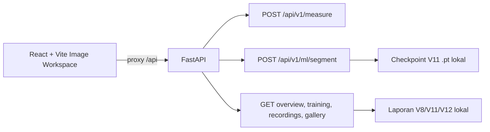

# Arsitektur sistem dan kontrak API

**Request ukur:** `{ "image_width":1000,"image_height":1000,"snout":{"x":500,"y":800},"tail_tip":{"x":500,"y":200},"reference_start":{"x":200,"y":400},"reference_end":{"x":200,"y":600},"reference_length_cm":10,"coplanar_confirmed":true,"length_definition":"total_length_straight_line" }`.

**Respons:** `status`, `method`, `length_definition`, `fish_length_px`, `reference_length_px`, `reference_length_cm`, `cm_per_pixel`, `length_cm`, `calibration_validity`, `ground_truth_accuracy_validated=false`, `warning`. **Segmentasi:** POST multipart `image`, query `conf=0.15`, `imgsz=512`; menghasilkan `objects`, `frame`, `fish_count`, `physical_length_cm=null`. Health ML hanya membuktikan keberadaan checkpoint. Endpoint lama `/api/v1/analyze` masih eksplorasi kontur, bukan alat pengukuran cm.

---

[Documentation index](README.md) · [Root README](../../README.md)
